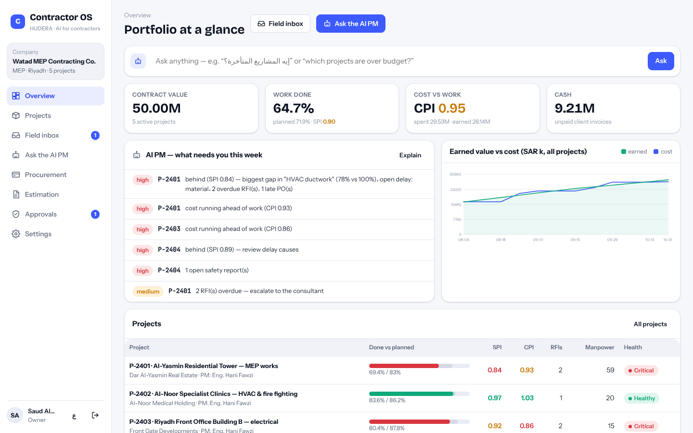
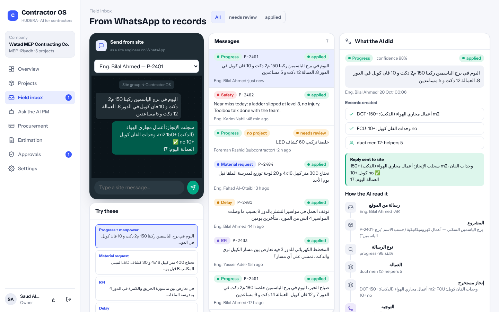
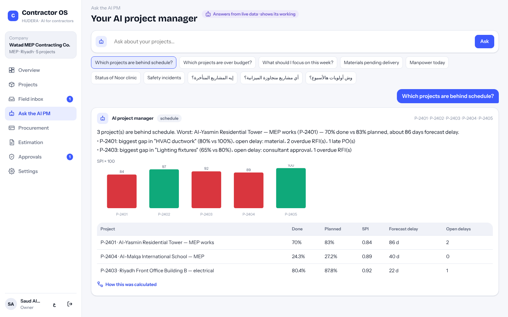
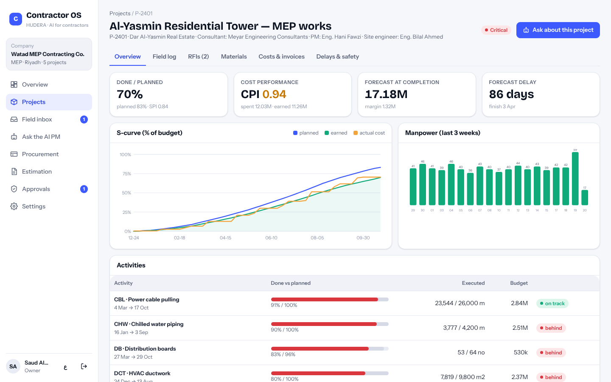
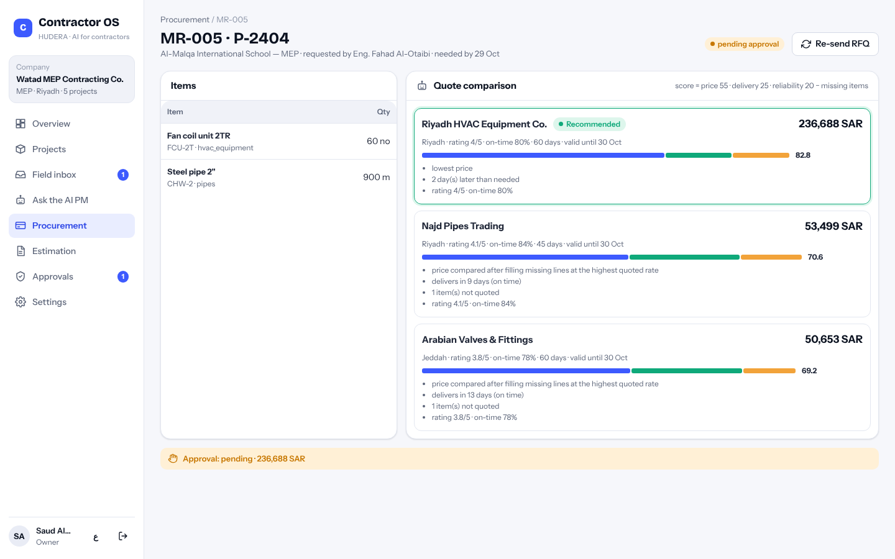
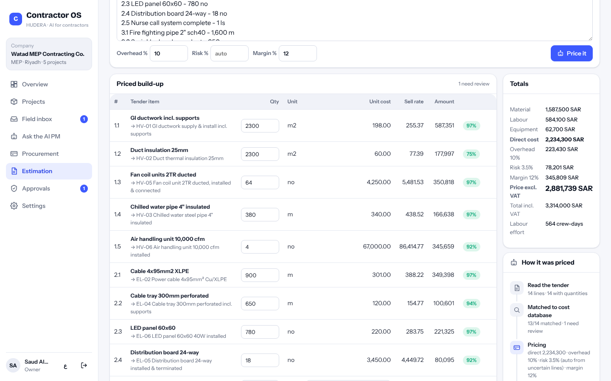
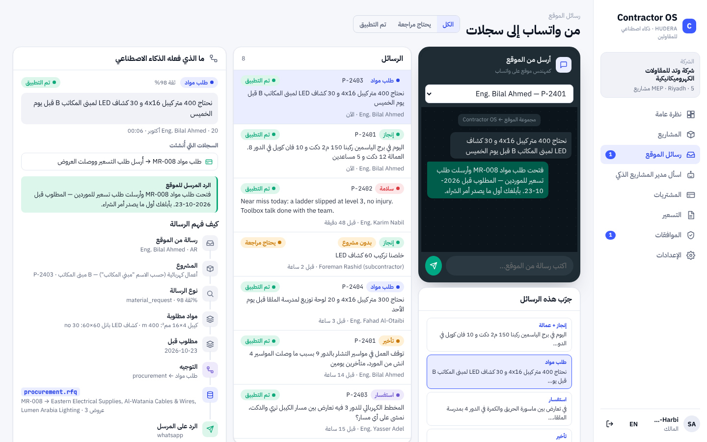

# HUDERA Contractor OS — AI operating system for specialty contractors

**For MEP, fit-out and specialty contractors.** Site engineers keep using WhatsApp; Contractor OS turns their messages into progress, manpower, material requests, RFIs, delay and safety records — and routes each one to the right person. An **AI project manager** answers management questions from live data, a **procurement agent** runs RFQs and recommends a supplier, and an **estimation agent** prices tenders from your own cost database.

**Live demo:** https://hudera-ai.github.io/contractor-os/ — runs entirely in your browser on sample data (pick any demo user, password `demo1234`).

> Demo data only. Watad MEP Contracting, Lamsa Fit-Out, their projects, clients, consultants, suppliers, people and prices are fictional.



## The four agents

| Agent | What it does | Where a human stays in control |
|---|---|---|
| **Field agent** | Reads a site message (Arabic or English) → finds the project (code, name people use on site, or the sender's assigned project) → classifies it (progress, material request, RFI, delay, safety, manpower) → extracts quantities, activities, materials, floors, dates → creates the records → replies to the sender. | Messages without a clear project wait in *needs review*; a PM assigns them in one click. |
| **AI project manager** | Answers “إيه المشاريع المتأخرة؟”, “which projects are over budget?”, “كم صرفنا على برج الياسمين؟”, open RFIs, materials pending, cash flow, manpower, safety, weekly priorities, or a summary of any project — with a table, a chart and the working (SPI = EV/PV, CPI = EV/AC, EAC = BAC/CPI). | Read-only: it explains, it doesn't change anything. |
| **Procurement agent** | Material request → picks suppliers by category → collects quotes → compares like-for-like (missing lines priced at the highest quoted rate) on price 55 · delivery vs needed-by 25 · reliability 20 → recommends → PO → delivery books the cost to the project. | Choosing a non-recommended quote needs a written reason; POs above SAR 50,000 go to the owner for approval. |
| **Estimation agent** | Tender / BOQ text (lists or tab-separated tables) → lines with quantities and units → matched to the cost database (material + labour + equipment) → overhead, auto risk, margin → selling rates, quotation and crew-days. | Unmatched or low-confidence lines are flagged, never guessed; the estimator picks the rate. |

| Field inbox | AI project manager |
|---|---|
|  |  |
| **Project (earned value, S-curve)** | **Procurement** |
|  |  |
| **Estimation** | **Arabic** |
|  |  |

Everything the AI does carries a step-by-step trace, so a PM can see *why* a message became an RFI or *how* a number was computed. The engine is deterministic (rules, dictionaries of site vocabulary in Arabic and English, earned-value maths) — predictable and auditable.

## Run it

```bash
npm install
npm start        # http://localhost:3000 — SQLite file in ./data, sample data on first run
npm test         # agents, AI PM, procurement scoring/approvals, estimation maths, tenancy & roles
npm run seed     # reset to the sample data
```

WhatsApp Business (Cloud API): point the webhook to `/webhooks/whatsapp` and set `WHATSAPP_VERIFY_TOKEN`, `WHATSAPP_TOKEN`, `WHATSAPP_PHONE_ID`. Senders are matched to users by mobile number; replies go back on WhatsApp (logged only when the token isn't set).

The same `index.html` also runs without a server (GitHub Pages / `?mode=local`): the service layer runs in the browser on SQLite (WebAssembly) and persists to IndexedDB.

## Architecture

```
index.html, src/          vanilla ES modules, no build step · Arabic (RTL) / English · light / dark · mobile
shared/service.js         every operation, tenant-scoped and role-checked (owner, pm, procurement, estimator, site_engineer, viewer)
shared/ai/field.js        site message → kind, project, quantities, materials, RFI, incident, routing, reply
shared/ai/pm.js           question → intent → scope → metrics → narrative + table + chart + trace
shared/ai/procurement.js  supplier selection, quote simulation (demo), like-for-like scoring
shared/ai/estimator.js    tender parsing, cost matching, build-up and totals
shared/metrics.js         earned value per project (PV, EV, AC, SPI, CPI, EAC, forecast delay)
server/src/               Express 5: /api/rpc/:op, WhatsApp webhook, static app
db/schema.sql             projects, activities, progress, costs, invoices, manpower, field messages, RFIs, incidents,
                          suppliers, catalogue, requests, quotes, POs, cost database, estimates, approvals, audit log
```

### بالعربي

**Contractor OS** نظام تشغيل بالذكاء الاصطناعي لمقاولي الأعمال الكهروميكانيكية والتشطيبات. مهندس الموقع يرسل على واتساب كالعادة، والنظام يحول الرسالة لإنجاز وعمالة وطلب مواد واستفسار للاستشاري وتأخير وسلامة، ويوجهها للشخص المناسب. مدير مشاريع ذكي يجاوب «إيه المشاريع المتأخرة؟» من البيانات الحية مع طريقة الحساب، ووكيل مشتريات يجمع العروض ويرشح المورد، ووكيل تسعير يسعّر المناقصات من قاعدة تكاليف الشركة. كل البيانات في العرض افتراضية.

---

Built by **HUDERA AI** · MIT licence
